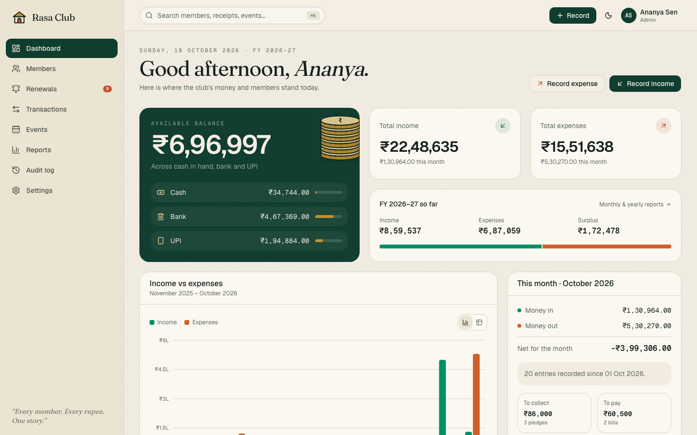
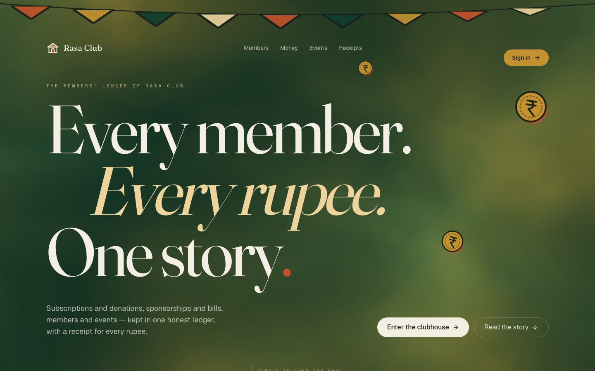
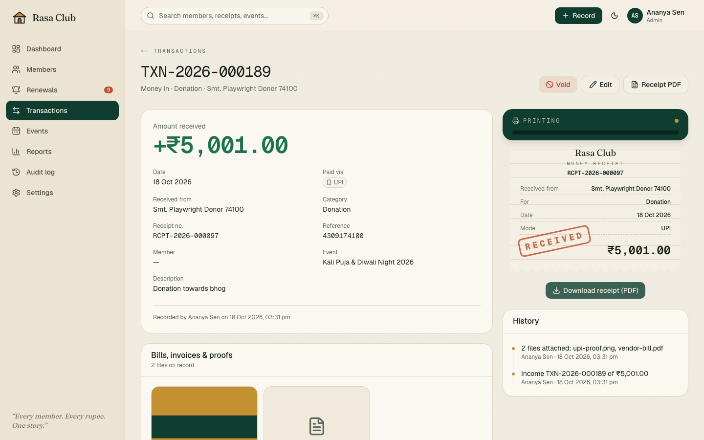
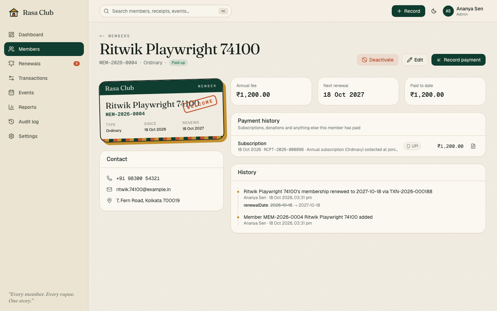

# Club Management System

**Every member. Every rupee. One story.**

A club ledger that is cinematic on the outside and effortless on the inside. The public site tells the club's story through scroll, with a first-visit intro where the clubhouse doors swing open, the ledger flips its pages and the club's name assembles letter by letter. Inside, treasurers get a calm, fast workspace for members, money and events.

| | |
|---|---|
|  |  |
|  |  |

## Features

**Financial dashboard.** Total income, total expenses and available balance (counters animate up). Cash, Bank and UPI balances are tracked separately. The dashboard also shows the current month and the Indian financial year (April–March), a 12-month income vs expense chart (with a table view), pending pledges and bills, outstanding membership dues, recent transactions, and event-wise finances.

**Members.** Member IDs are issued automatically (`MEM-2026-0042`). Each member has a profile with an illustrated membership card, phone, address, joining date, membership type and annual fee (overridable for concessions). Each profile shows payment history with receipt downloads and the member's change history. Deactivation is a soft delete with a reason, and can be reversed. Nothing is ever hard-deleted.

**Renewals.** The sidebar shows a badge with the due count. The dashboard has an "outstanding dues" panel. The renewals page lists overdue members and those due within 30 days, with one-tap **Call**, **WhatsApp reminder** (pre-written message) and **Collect** actions. A subscription payment automatically moves the member's renewal date forward by a year.

**Income and expenses.** Income is recorded as Donation, Subscription, Sponsorship or Other. Expenses are recorded against admin-managed categories. You can attach bills, invoices and payment proofs (JPG/PNG/WEBP/PDF, 5 MB each, up to 5 files). The server checks each file's real type from its first bytes, and stores files outside the web root. Pledges and unpaid bills can be recorded as **pending** and settled later. Mistakes are **voided**, never deleted.

**Numbering and receipts.** Transaction IDs (`TXN-2026-000123`) and receipt/voucher numbers (`RCPT-2026-000123` for income, `VCH-2026-000045` for expenses) come from gap-free yearly sequences, so a rolled-back save also returns its number. PDF receipts are generated on the server. They include the club's letterhead, the amount in words in Indian numbering ("Twelve Lakh Thirty Four Thousand…"), the payment mode and reference, and a RECEIVED/PAID stamp.

**Everything else.**
- Search and filters on every list, plus a global ⌘K search.
- CSV and Excel export of any filtered list. Excel uses ₹ lakh/crore number formatting.
- Monthly and yearly (FY) reports.
- An audit log of who changed what, with before/after values and IP.
- Three roles: Admin, Treasurer and Viewer.
- Dark mode.
- Fully responsive, from a 360 px phone upwards.

## Stack

- **Next.js 16** (App Router, Server Actions, Route Handlers, Cache Components with Partial Prerendering), TypeScript
- **Tailwind CSS v4** + **shadcn/ui** (Radix)
- **MySQL** via **Drizzle ORM** + drizzle-kit migrations (`mysql2` driver)
- **GSAP + ScrollTrigger**, **Lenis**, **Motion**, **Vanta.js / Three.js** (lazy-loaded hero fog)
- **Recharts** (palette validated for colour-blind separation in light and dark)
- **pdf-lib** (receipts), **exceljs** (exports), **bcryptjs** (passwords), **zod** (validation)
- **Playwright** (end-to-end tests and screenshots)

## Project structure

```
src/
  app/
    page.tsx                 public story (intro + landing)
    (auth)/login/            sign-in
    (app)/                   the signed-in app: dashboard, members, renewals,
                             transactions, events, reports, audit, settings, account, search
    api/receipts/[id]        PDF receipt / voucher
    api/attachments/[id]     authenticated file serving
    api/export/[entity]      CSV / Excel exports
    api/health               health check
  components/
    illustrations/           hand-built SVG illustrations (clubhouse, ledger, coins, members…)
    landing/                 intro sequence, landing chapters, smooth scroll, Vanta, proximity text
    app/                     app shell, charts, filters, tables, badges, empty states
    members/ transactions/ events/ settings/
  db/schema.ts               Drizzle schema (single source of truth)
  server/                    auth/session DAL, audit, sequences, uploads, receipt PDF, queries, actions
  lib/                       INR/date formatting, permissions, validation
drizzle/                     generated SQL migrations
scripts/                     migrate, seed, local throwaway MySQL
e2e/                         Playwright specs, fixtures, global setup
deploy/                      server setup + deploy scripts, PM2 file, Nginx server blocks, DB creation SQL
assets/fonts/                OFL fonts embedded in PDFs (support ₹)
```

## Running locally

Requirements: Node 20+ (tested on 24).

```bash
npm install
cp .env.example .env              # then edit DATABASE_URL etc.
npm run db:migrate                # apply migrations
npm run db:seed                   # settings, lookups, first admin (+ demo data if SEED_DEMO_DATA=true)
npm run dev                       # http://localhost:3000
```

No MySQL on your machine? `npm run db:dev` starts a throwaway MySQL 8.4 on port 3307. It downloads the official binary once, and `.env.example` shows the matching URL. To get demo Treasurer and Viewer accounts, run the seed with `SEED_DEMO_USERS=true` (local only).

### Environment variables

| Variable | Purpose |
|---|---|
| `DATABASE_URL` | `mysql://club_app:…@127.0.0.1:3306/club_management`. The dedicated, least-privilege user. |
| `DATABASE_POOL_SIZE` | Connection pool size (default 10). |
| `APP_URL` | Public origin. `https://…` turns on secure cookies. Printed on receipts. |
| `APP_PORT` | Port PM2 binds to on 127.0.0.1 (default 3105). |
| `UPLOAD_DIR` | Absolute path **outside** the web root for bills and proofs, e.g. `/var/lib/club-management/uploads`. |
| `UPLOAD_MAX_MB` | Max size per uploaded file (default 5). |
| `NEXT_SERVER_ACTIONS_ENCRYPTION_KEY` | Stable key so Server Action IDs survive restarts (`openssl rand -base64 32`). |
| `SEED_ADMIN_EMAIL` / `SEED_ADMIN_PASSWORD` / `SEED_ADMIN_NAME` | The first admin, created by `npm run db:seed` (password ≥ 10 chars). |
| `SEED_DEMO_DATA` | `true` loads demo members, events and transactions into an empty database. Keep it `false` in production. |

### Useful scripts

| Script | |
|---|---|
| `npm run db:generate` | Create a migration after editing `src/db/schema.ts` |
| `npm run db:migrate` | Apply pending migrations (safe to run on every deploy) |
| `npm run db:seed` | Idempotent seed (see above) |
| `npm run db:clear-demo` | Dry run listing what would be removed; add `-- --yes` to empty members, events, transactions, attachments and numbering (keeps users, settings and lookups) |
| `npm run test:e2e` | Full Playwright suite against a fresh `club_test` database and the production build |
| `npm run e2e:live` | Read-only smoke tests against https://club.rasatech.in (set `E2E_ADMIN_EMAIL`/`E2E_ADMIN_PASSWORD`) |
| `npm run typecheck` / `npm run lint` | |

## Database

Tables: `users`, `sessions`, `login_attempts`, `membership_types`, `members`, `events`, `expense_categories`, `transactions`, `attachments`, `counters`, `audit_logs`, `settings`. See [`src/db/schema.ts`](src/db/schema.ts) and [`drizzle/0000_init.sql`](drizzle/0000_init.sql).

- Money is `DECIMAL(12,2)`. Calendar dates are `DATE` (Indian dates). Timestamps are written in UTC and shown in IST.
- Balances only count `COMPLETED` entries. `PENDING` entries are pledges or bills, and `VOID` entries are kept for the record.
- `counters` holds the yearly sequences (`TXN-2026`, `RCPT-2026`, `MEM-2026`…). Numbers are taken inside the same transaction as the insert.
- The demo seed adds 42 members, 11 events (Durga Puja, Sports Meet, Blood Donation Camp…) and about 330 transactions from April 2025, with opening balances, pledges and a voided entry.

## Security

- Passwords are hashed with bcrypt (cost 12). Sessions are random 256-bit tokens; only their SHA-256 is stored, and they sit in `httpOnly`, `SameSite=Lax`, `Secure` cookies. Sessions last 7 days.
- Login is rate-limited per account+IP (5 failures / 15 min) and per IP (25). Failed logins are audited, and unknown emails take the same time to reject.
- Every Server Action and API route re-checks the session and role. The proxy only does an optimistic redirect.
- Uploads are validated by file signature and size, stored with random names outside the web root, and served only to signed-in users with `nosniff` and a sandboxing CSP.
- CSV exports neutralise spreadsheet formula injection.
- Security headers are set: X-Frame-Options, nosniff, Referrer-Policy, Permissions-Policy and HSTS (via Nginx).

## Deploying to the VPS

The site runs at **https://club.rasatech.in** on the VPS `93.127.206.52`. It is served by PM2 (`club-management`) on `127.0.0.1`, behind its **own** Nginx server block, with its own MariaDB database and user. Nothing else on the server is modified.

The VPS pulls the code from GitHub and builds it. Each deploy clones the branch into a fresh `releases/<timestamp>` folder, then installs, migrates and builds there. Only after that does it switch the `current` symlink and restart PM2. The live site keeps running the previous release while a deploy is building or if it fails, and a release that fails `/api/health` is rolled back automatically.

```
/var/www/club-management/
  current -> releases/20261018-125156   what PM2 runs
  releases/                             the last 2 builds (KEEP_RELEASES)
  shared/.env                           secrets, mode 600, linked into every release
  shared/logs/                          PM2 logs
/var/lib/club-management/uploads        bills and proofs (outside any web root)
```

### First-time setup

1. **DNS.** At the DNS provider for `rasatech.in`, add `A  club  93.127.206.52` (TTL 1 hour).
2. **On the VPS, as root:**
   ```bash
   git clone --depth 1 https://github.com/royal300/club-management.git /tmp/club-setup
   bash /tmp/club-setup/deploy/setup-server.sh
   ```
   It asks for the MariaDB `root` password (used once and never stored) and the first admin's email. Then it:
   - creates the `club_management` database and the `club_app` user, with a random password and rights on that database only, after checking that neither is already in use;
   - writes `shared/.env` with fresh secrets and picks a free port, 3105 or the next one up;
   - adds the Nginx block for the domain, removing it again if `nginx -t` fails;
   - runs the first deploy and seeds settings, lookups and the admin (no demo data);
   - gets a Let's Encrypt certificate (`certbot certonly --webroot`, so certbot never edits Nginx files) and turns on HTTPS.

   The admin password is printed once at the end. Change it under **Account** after signing in.

   If DNS isn't live yet, the site comes up over HTTP only. Re-run the script once `club.rasatech.in` resolves to get HTTPS; sign-in needs HTTPS because session cookies are `Secure`. Re-running is always safe, because existing pieces are kept.

   Options (env): `BRANCH`, `DOMAIN`, `DB_NAME`, `DB_USER`, `DB_HOST`, `DB_PORT`, `ADMIN_EMAIL`, `ADMIN_NAME`, `LETSENCRYPT_EMAIL`.

### Routine updates

Push to `main`, then either run this on the VPS:
```bash
bash /var/www/club-management/current/deploy/deploy.sh                  # deploys main
BRANCH=some-branch bash /var/www/club-management/current/deploy/deploy.sh
```
or run this from your computer: `DEPLOY_HOST=root@93.127.206.52 ./deploy/deploy.sh` (add `SSH_KEY=~/.ssh/key` for key auth).

The build runs on the VPS. If it is killed for lack of memory (exit 137), the live site is unaffected: add swap or free memory, then deploy again.

### Useful on the server

```bash
pm2 logs club-management                                    # app logs (also shared/logs)
pm2 restart club-management
cd /var/www/club-management/current && npm run db:clear-demo   # dry run; add -- --yes to delete demo data
ls /var/www/club-management/releases                        # previous build kept for rollback
```

To roll back by hand, point `current` at the previous release and restart:
```bash
ln -sfn /var/www/club-management/releases/<older> /var/www/club-management/current && pm2 restart club-management
```

## Design notes

- **Identity.** A heritage clubhouse: ledger-paper cream, billiard-felt green, brass, and a vermilion rubber stamp. **Fraunces** handles display type (its weight, WONK and optical-size axes drive the kinetic and proximity effects). **Geist** and **Geist Mono** handle the UI and figures.
- **Illustrations.** Hand-built SVG in a two-colour risograph style: ink outlines with a mis-registered shadow plate. Every animatable part carries a `data-part` hook.
- **Motion budget.** The landing page is maximal: GSAP pinning and scrubbing, Lenis, and a Vanta fog loaded on idle and only on capable desktops. Inside the app, transitions stay under 300 ms: a page turn between sections, counters, and two small celebrations (a receipt printing, and a membership card being stamped). `prefers-reduced-motion` disables the intro, smooth scrolling and all decorative motion. The landing page is fully static, so it is served from the prerendered shell.
- **Intro.** The intro shows once per browser. An inline script decides before first paint, so returning visitors never see a flash. Visitors without JavaScript never see it, and a CSS failsafe lifts it if the bundle fails to load.
